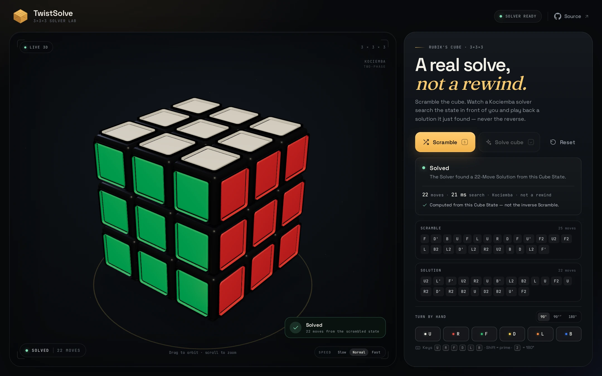

<p align="center">
  
</p>

<h1 align="center">TwistSolve</h1>

<p align="center">
  A 3D Rubik's Cube that scrambles, then <em>actually</em> solves itself.
</p>

<p align="center">
  <a href="https://gerrcass.github.io/twistsolve/"><strong>Live demo ↗</strong></a>
  &nbsp;·&nbsp;
  <a href="https://github.com/gerrcass/twistsolve/actions/workflows/ci.yml"></a>
</p>



## What it does

- **Scramble.** Resets the cube, generates a 25-Move Scramble, and turns it in 3D.
- **Solve.** Sends the current 54 Facelets to a Kociemba two-phase Solver in a Web Worker, receives a freshly searched Solution, verifies it against the engine, and plays it back.
- **Prove it.** A Solve Receipt reports Solution length, Solver search time, and that the Solution came from the current Cube State — not from rewinding the Scramble.
- **Play.** Orbit the cube, turn any face by hand, change the turn speed, and reset.
- **Everywhere.** Responsive down to a phone, keyboard-operable, and reduced-motion aware. No backend, no account, no tracking.

## Why the solve is real

The Scramble is display history. It is never passed to the Solver.

```text
25-Move Scramble ──► Cube State (26 transformed Cubies) ──► 54 Facelets
                                                                  │
                                                                  ▼
                                                     Solver Worker (Kociemba)
                                                                  │
                                                                  ▼
                              Move Queue ◄── engine verification ◄── Solution
                                   │
                                   ▼
                             3D playback
```

The Solver is the MIT-licensed [`cubejs`](https://github.com/ldez/cubejs) implementation of Kociemba's two-phase algorithm. It runs only inside the Solver Worker, so its pruning-table initialization never blocks orbit controls or Turn Animations. The main thread parses the returned Moves, re-applies them through the Cube engine, and refuses to play a Solution that does not reach the Solved State. The decision is recorded in [ADR-0001](docs/adr/0001-kociemba-solver-in-worker.md).

The cube itself is not a video: each Cubie owns its position and orientation, and every Move is an exact quarter turn. Facelets are derived from that state, so the Solver sees exactly what you see. See [ADR-0002](docs/adr/0002-transformed-cubies.md).

## Controls

| Action | Input |
| --- | --- |
| Scramble | Click **Scramble** or press <kbd>S</kbd> |
| Solve | Click **Solve cube**, press <kbd>Enter</kbd> |
| Reset | Click **Reset** or press <kbd>Esc</kbd> |
| Turn a face | <kbd>U</kbd> <kbd>R</kbd> <kbd>F</kbd> <kbd>D</kbd> <kbd>L</kbd> <kbd>B</kbd>, or the face buttons |
| Turn a face counterclockwise | Hold <kbd>Shift</kbd> with a face key, or use the `90°′` button mode |
| Turn a face 180° | Use the `180°` button mode or press <kbd>2</kbd> |
| Orbit / zoom | Drag / scroll on the cube |

Turn speed and Reduced Motion are respected during both Scramble and Solution playback.

## Development

Requires Node.js 22+.

```bash
npm install
npm run dev        # Vite dev server
npm run check      # lint + typecheck + unit/contract tests + build + bundle boundary
npm run test:e2e   # fresh build + Playwright browser path
npm run screenshot # capture assets/screenshot.png from a running preview
```

`npm run check` runs:

- ESLint 10
- strict TypeScript
- Vitest engine, reducer, and Solver contract tests
- production build
- a bundle boundary check proving `cubejs` appears only in the Solver Worker

The Playwright path covers Scramble → Solve → Solved, Reduced Motion, solving a hand-built state, keyboard focus survival, and a phone-width overflow check.

## Architecture

```text
src/
├── cube/       pure engine: transformed Cubies, Moves, Scrambles, Facelets
├── solver/     typed worker client, Solver adapter, worker
├── scene/      react-three-fiber stage, Cubies, Turn Animation
├── ui/         controls, Move lists, Solve Receipt, status
└── app/        reducer, Move Queue, solver hook, keyboard bindings
```

- [Domain language](GLOSSARY.md)
- [Architecture and invariants](docs/architecture.md)
- [Decisions](docs/adr/)
- [Why the product is shaped this way](docs/grill/2026-10-24-twistsolve.md)
- [Agent guide](AGENTS.md) and [coding standards](CODING_STANDARDS.md)

## Deployment

Every push to `main` publishes the production build to GitHub Pages with the official Pages actions. The site is live at **<https://gerrcass.github.io/twistsolve/>**.

## Credits

Built with [Vite](https://vite.dev), [React](https://react.dev), [TypeScript](https://www.typescriptlang.org), [Three.js](https://threejs.org), and [react-three-fiber](https://r3f.docs.pmnd.rs).

The Solver is [`cubejs`](https://github.com/ldez/cubejs) by Ludovic Fernandez and Petri Lehtinen, MIT-licensed. See [third-party notices](THIRD_PARTY_NOTICES.md). Typefaces are Space Grotesk, JetBrains Mono, and Fraunces via Fontsource, under the SIL Open Font License.
